# Diagrama de arquitectura

Documento para compartir con el equipo.

La **fuente de verdad es el código Mermaid**, plegado bajo cada imagen: vive en
el repositorio y se revisa en el mismo *pull request* que el Terraform que
describe, de modo que no puede quedarse desactualizado sin que alguien lo vea.
Los **SVG de `img/`** son una salida, para que el documento se lea igual en
GitHub, en un editor o en un PDF.

Tras tocar cualquier diagrama, regenerar con:

```bash
./docs/render-diagramas.sh
```

El script falla si algún diagrama no renderiza, así que un error de sintaxis se
detecta antes de entregar y no al abrirlo delante de quien lo revisa.

**Los seis diagramas están renderizados y verificados** con `mermaid-cli`.

---

## 1. Vista general


<details>
<summary>Codigo fuente del diagrama (Mermaid)</summary>

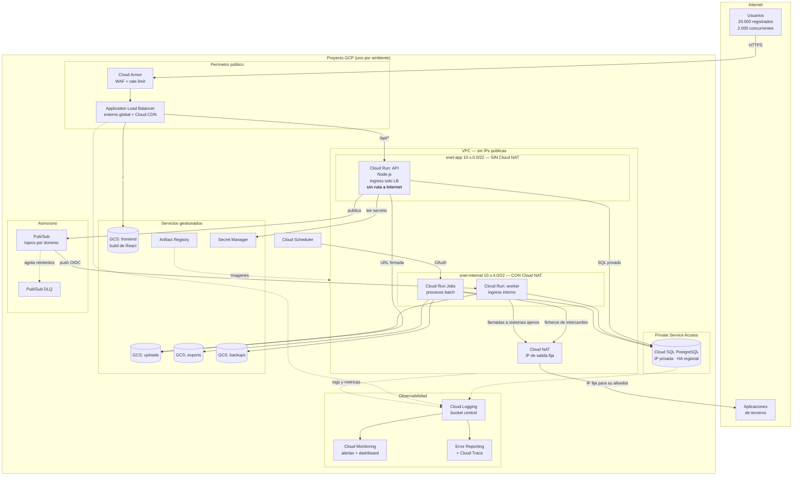

</details>

---

## 2. Flujo de una petición de usuario

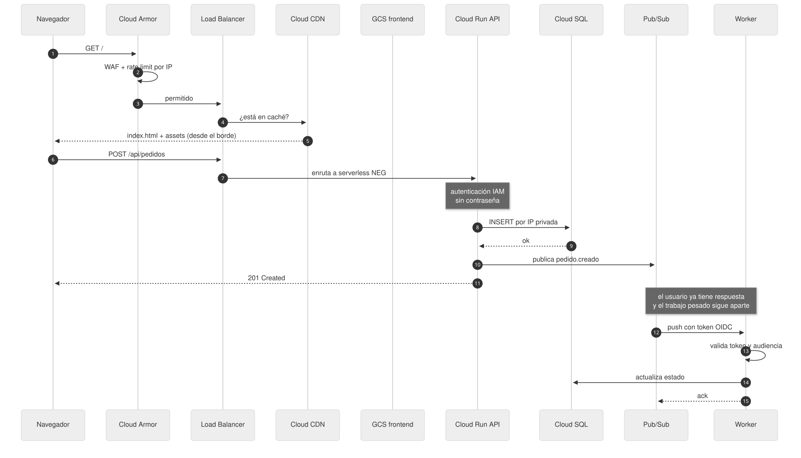

<details>
<summary>Codigo fuente del diagrama (Mermaid)</summary>

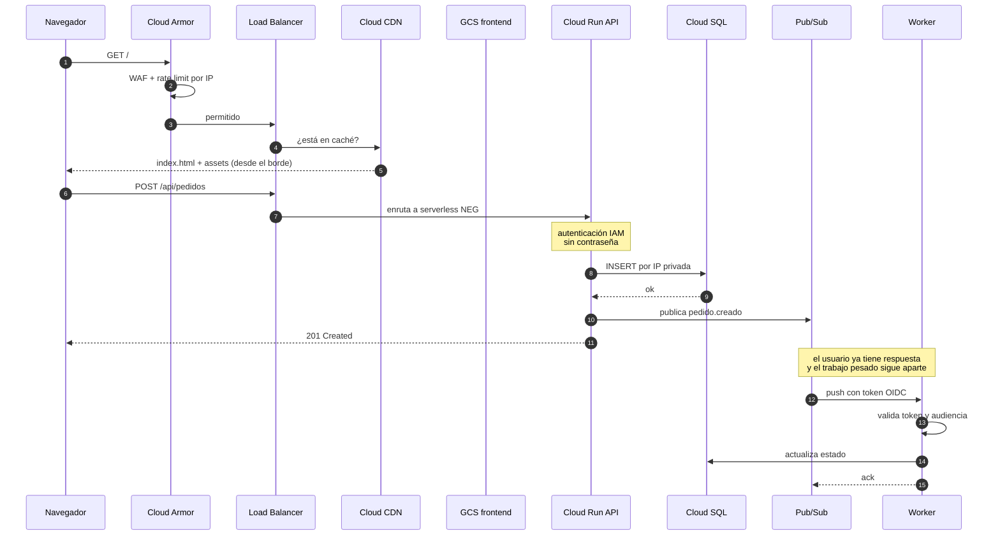

</details>

---

## 3. Por qué la base de datos no está expuesta

Es el requisito con nombre propio del enunciado, y se resuelve con tres capas:


<details>
<summary>Codigo fuente del diagrama (Mermaid)</summary>

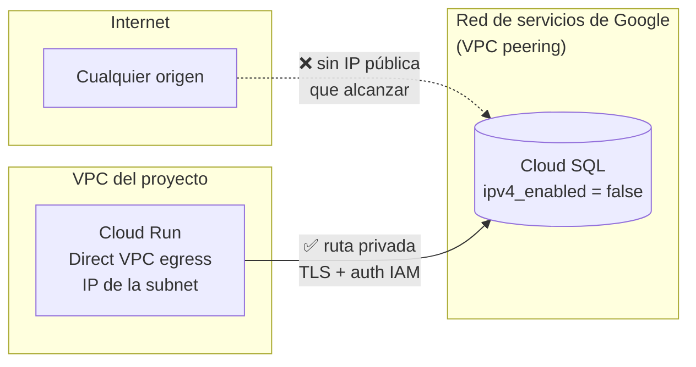

</details>

| Capa | Mecanismo | Qué impide |
|---|---|---|
| Red | `ipv4_enabled = false` sobre Private Service Access | No existe ninguna dirección pública hacia la que dirigir una conexión |
| Ruta | Direct VPC egress en Cloud Run + firewall de egress al 5432 | Solo las dos subredes de la plataforma alcanzan la instancia, y solo por ese puerto |
| Identidad | `cloudsql.iam_authentication` + usuarios de tipo service account | Aun con ruta, hace falta una identidad IAM autorizada; no hay contraseña que robar |

---

## 4. Separación entre componentes públicos y privados

El requisito pide esta separación y aquí se cumple en **tres planos a la vez**.
El plano de red es el que suele faltar, y es el que invierte la intuición:


<details>
<summary>Codigo fuente del diagrama (Mermaid)</summary>

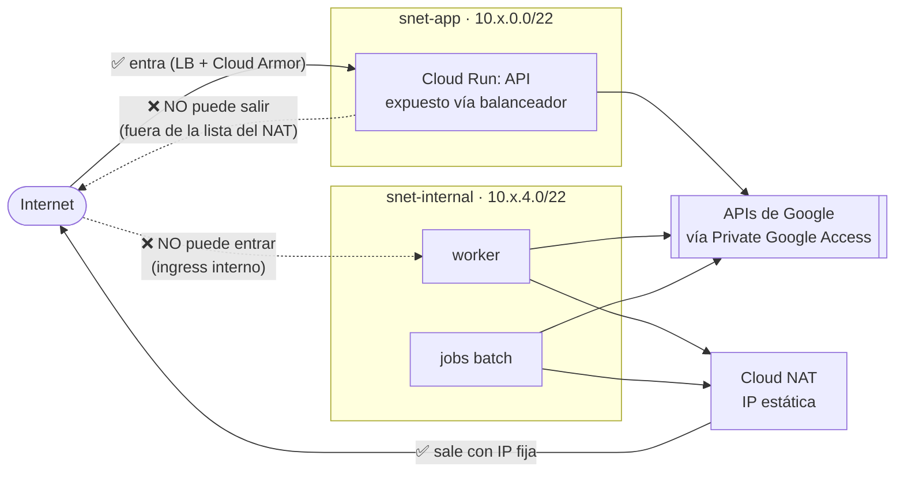

</details>

| Plano | Mecanismo | Resultado |
|---|---|---|
| Red | `snet-app` fuera de `LIST_OF_SUBNETWORKS` en Cloud NAT | El componente expuesto no puede iniciar conexiones a Internet |
| Egress | `vpc_egress = ALL_TRAFFIC` en los runtimes | Todo el tráfico de salida pasa por la VPC, así que la topología manda |
| Ingress | `INTERNAL_LOAD_BALANCER` en el API, interno en el worker | Nada se alcanza por su URL `run.app` |
| Identidad | Una service account por componente | Comprometer uno no da los permisos de los demás |

**Lo relevante:** si alguien lograra ejecutar código en el API —el único
componente que recibe tráfico de Internet— no tendría por dónde exfiltrar datos
ni por dónde descargar una segunda etapa. El control es la **ausencia de una
ruta**, no una regla de firewall que pueda relajarse. Ver
[decisiones.md, D5b](decisiones.md).

---

## 5. Separación entre ambientes


<details>
<summary>Codigo fuente del diagrama (Mermaid)</summary>

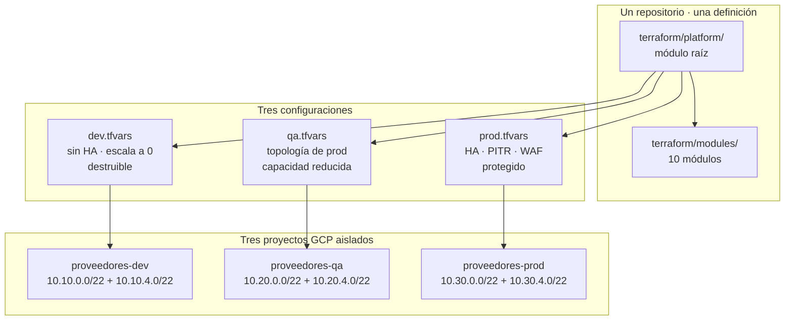

</details>

El aislamiento es por **proyecto**, no por etiquetas ni por prefijos de nombre:
el límite de IAM, de cuota y de facturación coincide con el límite del ambiente.
Un error de permisos en dev no puede alcanzar datos de producción.

---

## 6. Pipeline de CI/CD


<details>
<summary>Codigo fuente del diagrama (Mermaid)</summary>

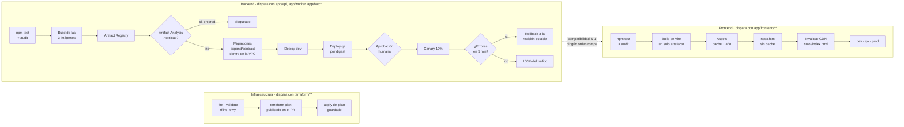

</details>

**Tres pipelines, no uno.** Cada uno se dispara con sus propias rutas y no
espera a los demás ([D9](decisiones.md), [D9b](decisiones.md)): un cambio de CSS
no paga el build de tres imágenes ni las migraciones, y un test del backend en
rojo no bloquea un arreglo de frontend.

La flecha discontinua es el contrato que lo hace seguro: el API mantiene
compatibilidad con la versión N-1 del cliente —obligatorio de todas formas,
porque el canary hace convivir dos revisiones sirviendo tráfico— de modo que
**ningún orden de publicación entre backend y frontend produce una combinación
incompatible**.

La imagen se promociona **por digest**, nunca reconstruyendo: el binario que
pasó las pruebas en QA es bit a bit el que entra en producción. El frontend
sigue el mismo principio con su artefacto: se construye una vez y se publica
tal cual en los tres ambientes.
